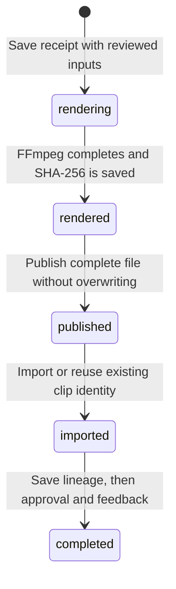

# Recoverable clip approval

Implemented 2026-09-30. The original media remains untouched.

The receipt belongs to the proposal and is persisted in the existing JSON store.
Retries use its original trim, layout, filename and output path. The UI exposes
**Finish Saved Approval** after an interrupted approval. A completed render is
reused; an unconfirmed or partial render is recreated from the unchanged source.
No external upload is performed by recovery.

Renders are staged under the library's `.creator-workbench-approvals` subdirectory,
outside the nonrecursive library watcher. Publishing uses a same-volume hard link
to expose a complete file without overwriting a competing destination. This requires
a filesystem supporting hard links (such as NTFS). Unsupported filesystems fail
with the staged render retained. The staging link is removed after success;
the library file is never removed by approval failure cleanup.

Persisted stages can lag filesystem/import effects when a write fails. Retrying
recognizes the already-linked file and reuses the import by path. Hash checks
reject changed output. Concurrent approvals of one proposal are rejected; pending
receipts reserve output names and prevent proposal regeneration. Missing records,
changed source/output, or unrelated destination collisions stop for repair rather
than overwrite or silently render duplicates. Receipts created before this change
do not exist, so older orphaned renders require manual repair.

At startup, after obtaining the single-instance lock, queued/running jobs from the
previous process become interrupted. Terminal jobs stay terminal; uncertain uploads
retain their separate reconciliation flow. Startup does not restart media work or
contact YouTube. Existing whitespace-only database files now fail closed and remain
untouched instead of being initialized as a new store.

Validation: `clipApprovalRecovery.test.cjs` injects stage failures and checks restart,
identity reuse, partial rendering, collisions, concurrent calls and altered files.
`startupRecovery.test.cjs` launches the actual compiled main entrypoint in a fresh
process with mocked Electron/media adapters and real temporary persistence.
Compile Electron before running tests, because tests import `dist`.
