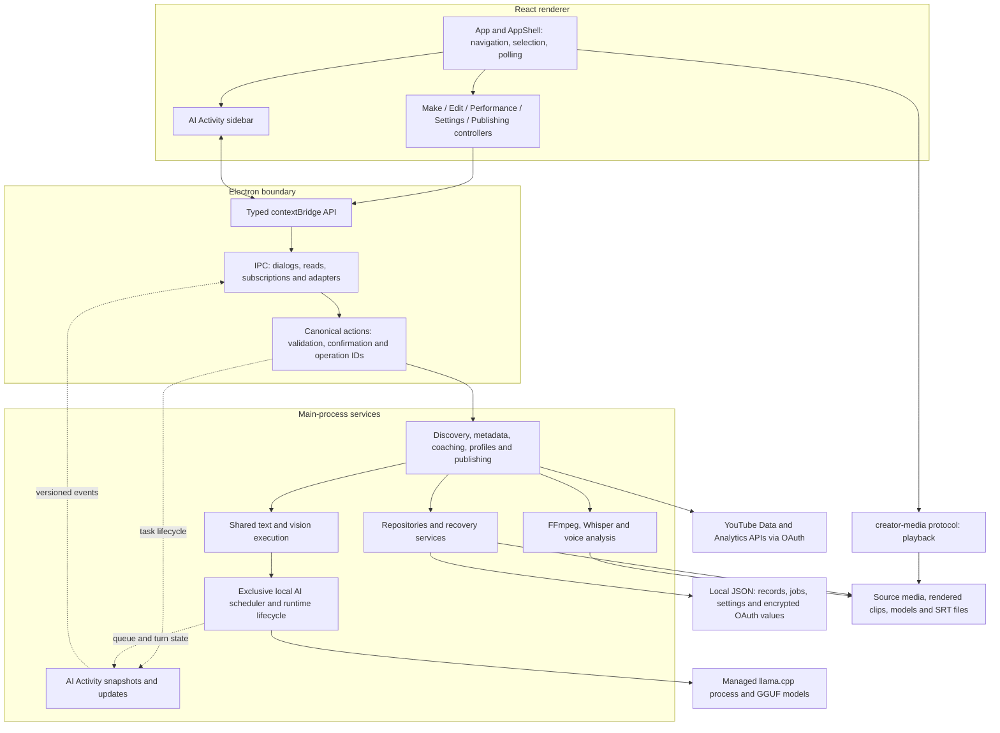
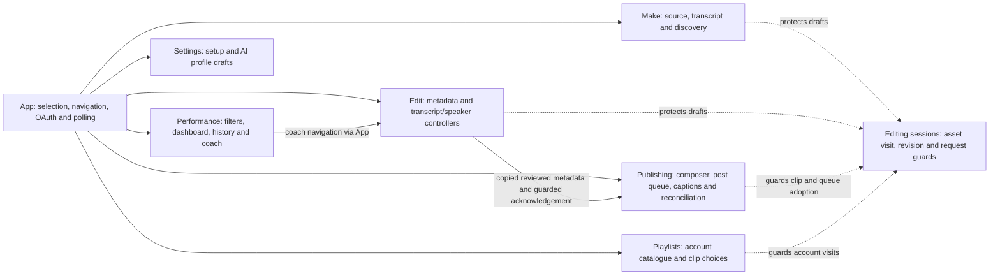

# Creator Workbench: current architecture

Source inspection: 2026-10-23, current working tree (including uncommitted changes).
This is the implemented architecture, not a target design.

## System and ownership

The overview groups indirect calls; arrows are responsibility/data-flow paths,
not a claim that every connected module directly imports the next. Playback is
main-process protocol handling; preload provides the renderer's media URLs.
Seventy-six actions currently have exactly one registered handler each.

## Renderer boundaries and reviewed handoffs

Publishing snapshots the chosen clip, package, account, playlists and time.
Post recovery owns a post independently of the selected Edit clip. Older queue
snapshots cannot replace newer mutations. The shell still owns background polling
policy, OAuth/connection presentation and data-management integration; the
extraction does not make App a minimal navigation-only component.

## AI, jobs and recoverability

- Feature services choose task/profile, build bounded evidence and validate model
  output. Text/vision inference uses one execution boundary and one scheduler.
  Each inference turn has exclusive runtime ownership; a multi-stage workflow
  can yield between turns. Whisper/FFmpeg remain separate processes.
- AI Activity is bounded presentation state with versioned snapshots, distinct
  from persisted jobs. Supported cancellation follows the existing owning
  workflow; the sidebar does not make every operation cancellable.
- Feedback retrieval is scoped to its originating task/profile and bounded.
  It does not silently rewrite saved prompts, assignments or scoring rules.
- Startup and orderly shutdown mark unfinished jobs interrupted and uncertain
  uploads for reconciliation. This is recoverability, not universal automatic
  resumption. Approval receipts, artifact hashes and collision checks support
  reuse of the original rendered artifact without overwriting another file.
- The canonical action boundary gives input/confirmation checks and operation
  context. It is not a transaction manager, durable configuration audit log or
  universal operation deduplication mechanism.

## Persistence, files and external publishing

The current database schema is version 4 and uses a local JSON document.
Repositories validate/normalize records and serialize replacement writes.
The [entity reference](creator-workspace-data-flow-and-erd.md) lists physical
collections and logical relationships. AI profiles/knowledge, people/voice
samples and protected OAuth values are nested settings, not separate tables.
Secrets/tokens are encrypted through Electron safeStorage and stored as protected
settings values; the JSON file still contains their encrypted representation.

Source files, rendered clips, managed runtime/model files, thumbnail files and
exported SRT remain ordinary filesystem artifacts. Media playback goes through
the privileged creator-media protocol.

YouTube scheduling uploads immediately, then uses YouTube's native scheduling
when applicable. Complete clip transcript SRT is uploaded separately as captions;
caption failure does not undo video upload. Retry/reconciliation remain explicit.
Export SRT always offers Save As, initially in the configured SRT folder; that
exported copy is not the caption-upload input. Existing uploaded caption tracks
are not automatically replaced following transcript edits. TikTok remains a
local draft handoff.

Current thumbnail candidates copy extracted frames or an existing thumbnail and
attach an AI vision brief. This path does not synthesize new image pixels.
Actual AI image synthesis remains an unmet capability; no generator is implied
by the diagram.

## Source evidence

| Source | Symbol | Responsibility |
| --- | --- | --- |
| `src/renderer/App.tsx` | `usePublishingWorkflow` | Controller composition, selection and shell handoffs |
| `src/renderer/AppShell.tsx` | `AiActivityQueue` | Persistent navigation and activity presentation |
| `src/renderer/edit/useEditMetadataWorkflow.ts` | `captureReviewedMetadata` | Reviewed package and guarded save acknowledgement |
| `src/renderer/publishing/usePublishingWorkflow.ts` | `capturePostsRead` | Publishing state and obsolete queue-read rejection |
| `src/renderer/publishing/useYouTubePlaylists.ts` | `youtubeAccountKey` | Account-scoped catalogue requests |
| `src/renderer/useEditingSession.ts` | `EditingSession` | Visit/revision/request acceptance |
| `src/electron/main.ts` | `markRunningJobsInterrupted` | Startup/shutdown and resource ownership |
| `src/electron/preload.ts` | `contextBridge.exposeInMainWorld` | Typed isolated renderer API |
| `src/electron/ipc/registerHandlers.ts` | `executeLegacyAction` | Dialogs/read handlers and mutation adapters |
| `src/shared/appActions.ts` | `APP_ACTION_DEFINITIONS` | Action catalogue and confirmation metadata |
| `src/electron/actions/appActionExecutor.ts` | `executeAppAction` | Confirmation, registration and operation context |
| `src/electron/actions/registerCreatorWorkflowActions.ts` | `registerCreatorWorkflowActions` | Core workflow implementations |
| `src/electron/actions/registerRemainingActions.ts` | `registerRemainingActions` | Remaining settings/profile/export writes |
| `src/electron/actions/remainingActionSchemas.ts` | `parseRemainingAction` | Validated boundary inputs |
| `src/electron/services/aiExecutionService.ts` | `executeAiRequest` | Shared text/vision outcome boundary |
| `src/electron/services/localAiScheduler.ts` | `LocalAiScheduler` | Exclusive turns and waiting cancellation |
| `src/electron/services/localAiRuntimeService.ts` | `runtimeScheduler.run` | Model lifecycle and inference ownership |
| `src/electron/services/aiActivityService.ts` | `trackAiAction` | Activity presentation and event state |
| `src/electron/services/aiProfileLearningService.ts` | `buildAiProfileLearningPrompt` | Scoped evidence context |
| `src/electron/services/database.ts` | `CreatorWorkspaceStore` | Physical persisted collections |
| `src/electron/services/clipApprovalRecovery.ts` | `publishApprovalArtifact` | Verified artifact adoption without overwrite |
| `src/electron/services/localMediaProtocol.ts` | `createLocalMediaResponse` | Renderer playback boundary |
| `src/electron/services/youtubeService.ts` | `uploadYouTubeCaptions` | External captions and OAuth integration |
| `src/electron/services/youtubeCredentialStore.ts` | `persistStoredYouTubeSession` | Protected OAuth settings |
| `src/electron/services/thumbnailGenerationService.ts` | `decodeImageDataUrl` | Actual thumbnail file creation |

## Refresh and verification

Use the installed `$creator-workbench-architecture` skill. It inspects source,
updates this overview and the entity reference, then records and checks
`architecture-source-snapshot.json`. Its source hashes identify later changes;
they do not prove that a diagram is semantically correct.

This refresh inspected source, checked evidence anchors and action registrations,
and validated the reusable skill. It made no application changes. The preceding
code verification reported 222 passing tests; the user reported subsequent tests
successful. That historical result is separate from this documentation audit and
does not certify every capability or edge case.
