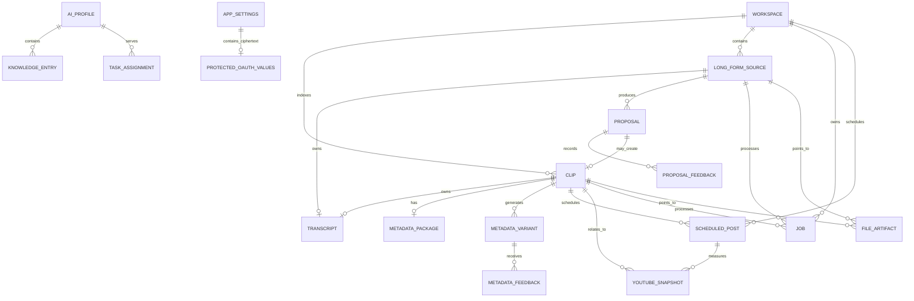

# Creator Workbench Data Flow and Entity Reference

Status: Current implementation reference
Last reconciled: 2026-10-23 (source-backed workflow, action, lifecycle and credential corrections)

See the [current system and ownership diagrams](creator-workbench-architecture.md)
for the renderer controllers, reviewed publishing handoff, shared AI scheduler
and source evidence.

This document describes the current Creator Workbench architecture. Sections marked **Recommended** are improvements, not claims about behaviour already implemented.

## System Boundary

Creator Workbench is a Windows-first, single-user Electron application with a React/TypeScript/Vite renderer. The main process owns persistence, local media access, child processes, local AI runtimes, and external platform calls.

```text
React screens and components
        |
        v
Typed contextBridge preload API
        |
        v
Electron IPC handlers and app-action executor
        |
        v
Workflow actions and application services
        |
        v
Repositories and JSON persistence boundary
        |
        +--> creator-workspace.json in the user data directory
        +--> source and output video/SRT files
        +--> FFmpeg, Whisper, and llama.cpp child processes
        +--> Google/YouTube APIs through OAuth
```

The renderer does not access the JSON database or local files directly. Media playback uses the privileged `creator-media` protocol through the preload-exposed local media URL helper.

Performance extraction (2026-10-19): `usePerformanceWorkflow` now owns the channel dashboard's state and API requests. `App.tsx` retains navigation, selected-clip snapshots and coach-to-Edit handoffs. See [Performance controller boundaries and verification](performance-workflow.md).

Make extraction (2026-10-20): `useMakeWorkflow` owns long-form preparation and clip discovery. Approval/library adoption and navigation remain shell handoffs. See [Make controller boundaries and verification](make-workflow.md).

Edit extraction (2026-10-20): `useEditWorkflow` coordinates selected-clip records and composes separate metadata and transcript/speaker controllers. Navigation, playback and polling remain shell integrations. Publishing now owns its own [controller and reviewed metadata handoff](publishing-workflow.md).

Settings extraction (2026-10-21): `useSettingsSetupWorkflow` owns local setup operations and `useAiProfileSettings` owns explicit profile/assignment drafts. The shared application snapshot and cross-feature integrations remain in the shell. See [Settings controller boundaries and verification](settings-workflow.md).

Shared AI boundary (2026-10-21): current text/vision feature callers use `aiExecutionService`, retaining the existing runtime scheduler. Canonical actions can carry structured outcomes across IPC; Make consumes them directly. See [AI execution and outcome boundaries](shared-ai-execution.md).

Session ownership and scoped learning (2026-10-21): Edit/Make command completions and timed-panel saves have [editing-session guards](editing-session-ownership.md). Automatic feedback and style examples now use [profile-scoped, bounded learning context](scoped-ai-learning.md).

## Persisted Entity Model

The database is one JSON document containing these collections:



### Current Record Responsibilities

| Record | Current purpose | Key relationships and lifecycle |
| --- | --- | --- |
| `workspaces` | Workspace identity and timestamps. | Owns clips, long-form sources, jobs, and scheduled posts. |
| `clips` | Imported or approved short-form media records. | Active/archived index state; stores source path, media metadata, workflow status, lineage-related identifiers, and an optional source fingerprint. Re-importing a compatible archived file reactivates the record; a changed file at the same path gets a new record. |
| `longFormSources` | Original long-form media records. | Separate active/archived source index; proposals and long-form transcripts belong here. Source fingerprints prevent changed media at a reused path from silently inheriting old history. |
| `transcripts` | Canonical timed transcript, text, SRT, model, language, and speaker segments. | Owned by `assetType` plus `assetId`; legacy `clipId` remains for compatibility. SRT is derived from canonical timed segments. |
| `clipProposals` | Candidate ranges from long-form analysis. | Owned by a long-form source; transitions between proposed, approved, and rejected. |
| `clipProposalFeedback` | Durable approval, rejection, reopen, range, layout, and decision history. | Preserved separately from the current proposal state for learning and auditability. |
| `metadataPackages` | Saved title, description, tags, and readiness package. | One current package per clip; scheduling uses the saved package. |
| `metadataVariants` | Generated candidate title, description, and tag variants. | Linked to a clip and generation; local task/profile/model and input-record provenance is retained without prompt text or secrets. Feedback is stored separately. |
| `metadataFeedback` | Accepted/rejected candidate decisions. | Historical signal for later profile learning, linked to the generating variant's provenance. |
| `youtubeVideoCache` | Cached owned-channel videos. | Remote video identity and local owned-library evidence; external refresh is explicit. |
| `youtubeMetadataDrafts` | Local drafts for owned YouTube videos. | Separate from clip metadata packages; remote application is a distinct user action. |
| `thumbnailCandidates` | Generated thumbnail candidate records. | Candidate selection/storage is separate from applying a thumbnail to YouTube. |
| `scheduledPosts` | YouTube/TikTok post records and platform state. | Links a clip to account, publish time, remote ID, URL, status, and caption status. |
| `youtubePerformanceSnapshots` | Owned YouTube performance observations. | Linked to a scheduled post, remote video, and where available a clip. |
| `importedYouTubePerformanceRecords` | Historical channel records imported from YouTube. | Preserved as historical performance evidence, including records without a local clip. |
| `jobs` | Durable operation state and progress. | Explicit `assetType`/`assetId` ownership is normalized for legacy records; `clipId` remains a compatibility alias. |
| `appSettings` | Folders, runtime settings, profiles, people, automation, and preferences. | Sensitive OAuth values are held through the protected credential store rather than normal plaintext settings. |

AI profiles, knowledge entries, task assignments, voice samples and protected OAuth values are nested settings rather than separate top-level collections. Their diagram nodes describe logical relationships. OAuth secrets/tokens are encrypted with Electron safeStorage and stored as protected settings values in the JSON document. Physical media, exported SRT, managed model files and runtime binaries live in the filesystem.

## Command and Query Boundaries

The typed action catalogue includes these relevant current workflows:

| Area | Actions |
| --- | --- |
| Make | `long_form.import`, `long_form.transcribe`, `long_form.cancel_transcription`, `long_form.save_partial_transcript`, `long_form.discard_partial_transcript`, `long_form.generate_proposals`, `long_form.cancel_proposals`, `long_form.approve_proposal`, `long_form.reject_proposal`, `long_form.reopen_proposal` |
| Edit | `clips.import`, `clips.transcribe`, `clips.generate_metadata`, `clips.save_metadata`, `transcripts.update`, `transcripts.auto_assign_speakers`, `clips.export_trimmed`, `clips.remove_from_workspace`, `clips.delete_app_data`, `scheduled_posts.create`, `scheduled_posts.retry_captions`, `scheduled_posts.reconcile`, `scheduled_posts.refresh_statuses` |
| Performance and learning | `performance.refresh_dashboard`, `performance.generate_coach`, `performance.import_youtube_history`, `metadata.record_feedback` |
| Owned YouTube library | `youtube_videos.refresh`, `youtube_videos.save_draft`, `youtube_videos.generate_metadata`, `youtube_videos.update_metadata`, `youtube_videos.bulk_update_metadata`, `thumbnails.generate_candidates`, `thumbnails.save_candidate`, `thumbnails.apply_to_youtube` |
| Settings and data | `data_management.scan`, `data_management.clear_clip_library`, `data_management.clear_long_form`, `data_management.cleanup_orphans`, `ui.save_vertical_layout_preferences` |

The catalogue currently contains 76 actions, each with one registered handler. The table above groups the original workflows rather than listing the complete catalogue. Remaining settings/profile, credential, runtime/model, folder and export writes now have [canonical actions](application-action-boundary.md). Public preload methods may still invoke compatibility IPC channels, but those channels delegate writes through the same executor. Native dialogs, reads, subscriptions and result formatting stay in IPC. Confirmation and request/operation context do not constitute a durable audit log.

## End-to-End Data Flows

### Startup and Shutdown

1. Electron bootstraps the JSON database and normalizes/migrates records.
2. The main process initializes folders, local AI runtime state, watcher state, and IPC handlers.
3. Startup marks uncertain posting records for reconciliation and unfinished queued/running jobs interrupted. It preserves terminal jobs; it does not automatically resume every interrupted workflow.
4. The renderer requests `AppInfo`, indexes, jobs, profiles, and connection state.
5. On shutdown, owned jobs are marked interrupted, watchers and transcription processes are disposed, and the app-owned local AI runtime is cleaned up. A separately running Ollama service is not stopped.

### Make: Long-form to Approved Clip

1. `LongFormProposalPanel` imports or selects a source through the preload API.
2. Transcription extracts audio through FFmpeg and runs the selected Whisper backend.
3. Canonical transcript segments and derived SRT are saved against the long-form source.
4. Proposal generation uses transcript windows, media/audio evidence, sampled frames where available, the Clip Discovery profile, and the app-owned local AI runtime. The stored proposal retains task/profile/model, source/transcript input IDs, and execution-mode provenance.
5. Parsed candidates are validated and stored in `clipProposals`; decisions are stored in `clipProposalFeedback` with the proposal's provenance and the selected range/layout.
6. `ProposalDecisionPanel` approves or rejects a proposal. Approval renders a new file without overwriting the source, creates/reactivates a Clip Library record, and preserves source/proposal lineage.

UI components: `LongFormProposalPanel`, `VideoPlayer`, `TimestampedTranscriptPanel`, `ReviewClipView`, `ProposalDecisionPanel`, and trim/layout controls.

### Edit: Transcript, Speakers, Metadata, and Publishing

1. `Clip Library` selects a clip and loads its transcript, metadata, variants, scheduled posts, and performance snapshots.
2. `VideoPlayer` and `TimestampedTranscriptPanel` seek and edit the selected media.
3. Transcript saves update canonical text, timed segments, speaker assignments, and derived SRT together.
4. Metadata generation reads the transcript, AI profile, knowledge, and prior candidate context, then stores validated variants.
5. The user selects/edits a package and explicitly saves it.
6. Publishing captures the reviewed clip/package/account/time/playlists, saves that package and creates a scheduled post. YouTube upload/native scheduling updates the remote ID and status. Guarded acknowledgements and queue snapshots protect newer drafts and recovery results.
7. Eligible complete canonical SRT is uploaded as captions after YouTube publishing. Caption failure does not undo the video upload and remains retryable.
8. Export SRT opens Save As in the configured SRT folder, if present. The exported copy is independent of the canonical SRT used for YouTube captions. Existing caption tracks are not automatically replaced after transcript edits.

UI components: `VideoPlayer`, `TimestampedTranscriptPanel`, speaker review controls, metadata candidate sections, `SchedulePostComposer`, `QueuedPostsPanel`, and `QueuedPostCard`.

### Performance

1. `PerformanceDashboardView` edits account-focused filters locally without platform calls.
2. An explicit refresh pulls owned YouTube channel and Analytics data, plus local workspace evidence where available.
3. Results are stored as owned performance snapshots and imported history, then shown with provenance and timestamps.
4. The Performance Coach uses owned-channel evidence, local transcripts, speaker context, and saved creator knowledge only.

### Settings and Data Management

Settings actions configure folders, runtimes, models, profiles, people, credentials, and automation. `DataManagementPanel` summarizes active/archive counts, performs read-only orphan scans, archives indexes, and runs reviewed cleanup with backup and active-job safeguards. No timer or implicit platform refresh is introduced.

## Current Invariants

- Original source media is never overwritten by trim or approval rendering.
- Archived index records preserve history and can be reactivated by matching compatible re-imports; source fingerprints prevent silent history attachment to changed media.
- Long-form and clip transcripts are separate owners.
- Manual speaker labels take priority over automatic matching.
- Proposal rejection renders no file; approval is intended to be idempotent.
- Metadata scheduling uses an explicitly saved package.
- Performance platform pulls are manual-only and scoped to the user's owned YouTube account.
- AI, fallback, Strict AI, and runtime failures remain visible, while generation and decision records retain non-secret provenance.
- Complete canonical SRT is required for captions; caption failure does not undo upload.
- OAuth secrets and tokens are not persisted as normal plaintext JSON settings.

## Hardening Status

The first hardening slices are implemented and verified:

- Database records carry schema version `4`; ordered migrations normalize legacy records and safely rewrite them.
- Database writes use a temporary file, flush it, and replace the main JSON document only after the write succeeds.
- Present persisted collections are validated as arrays (and settings as an object) before migration; malformed records are reported as protected data-health findings rather than silently discarded.
- Core workflow actions are registered through the action executor; legacy IPC mutations delegate to those actions where a canonical action exists.
- Long-form cancel/partial recovery, proposal cancellation/reopen, layout preference writes, performance/data-management mutations, and feedback writes use typed action definitions with correlation context.
- Jobs identify `clip`, `long_form_source`, or `workspace` ownership through `assetType`/`assetId`, while old `clipId` data remains readable.
- Approved long-form clips carry source, proposal, selected time-range lineage, and validated references. Data-health scans report broken lineage, malformed records, and missing media without deleting useful history.
- Renderer refreshes reconcile clip, source, and proposal selection so stale IDs are cleared or replaced with a valid selection.
- Metadata variants, proposal records, and feedback retain local AI task/profile/model and source/input provenance without storing secrets or prompt text. Public trend records and trend-specific provenance are removed by the schema 4 cleanup migration.

The source-to-proposal-to-clip-to-post relationship remains represented by existing record references rather than a separate lineage table. Scheduled posts link approved clips, and remote IDs/URLs link local posts to platform results.

## Historical Recommendations

The following recommendations were recorded before the first hardening slices. Completed items are retained here as historical context; remaining items are explicitly marked.

These are not implemented by this document:

1. **Completed:** Database schema versioning, ordered legacy normalization, atomic writes, serialized writes, and present-collection shape validation.
2. **Completed:** Typed `assetType`/`assetId` job ownership with the legacy `clipId` compatibility alias.
3. **Completed for current renderer-requested writes:** IPC adapters delegate mutations through validated canonical actions; native dialogs and reads remain in IPC. See [application action boundary](application-action-boundary.md). Service-owned startup/background work remains internal.
4. **In progress:** Existing typed lineage references cover source → proposal → clip → scheduled post → remote post; a separate lineage table is not yet necessary for the current MVP.
5. **Completed for current records:** Data-health validation reports malformed records, missing approved-clip relationships, and missing media without deleting records. Broader relationship repair remains future work.
6. **In progress:** Renderer selection reconciliation and Performance, Make, Edit, AI/local-setup Settings and [publishing controllers](publishing-workflow.md) are extracted. The shell retains navigation, connection/OAuth, data management and workspace polling policy.
7. **Completed for current renderer mutation routes:** Request/operation IDs are assigned at the action boundary, including compatibility adapters. This is not a durable audit log or automatic retry/deduplication guarantee.
8. **Current decision:** Keep JSON for the current MVP; consider indexed reads or SQLite only after measuring actual persistence pressure and recording a new ADR.

## Verification Reference

The architecture record is verified against the current source by checking:

- `src/shared/contracts.ts` for entity contracts.
- `src/electron/services/database.ts` for persisted collections and migrations.
- `src/shared/appActions.ts` and `src/electron/actions/` for catalogue actions.
- `src/electron/preload.ts` and `src/electron/ipc/registerHandlers.ts` for the public bridge and compatibility routes.
- Renderer screen/components for user-facing entry points.
- Existing tests for persistence, workflow safety, local AI, transcription, captions, and data management.
