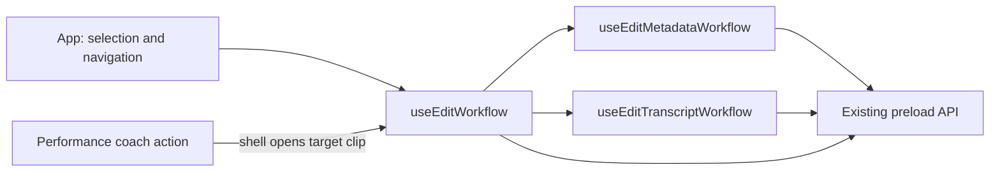

# Edit renderer controllers

Implemented 2026-10-20.

`src/renderer/edit/useEditWorkflow.ts` coordinates selected-clip reads for metadata,
variants, transcripts and YouTube performance snapshots. It composes two focused
controllers with injectable subsets of the existing preload API:

- `useEditMetadataWorkflow` owns metadata drafts, candidate selection/rejection,
  explicit feedback, background scoring, save/generate state, profile-block
  insertion and metadata generation requested by the Performance coach.
- `useEditTranscriptWorkflow` owns transcript drafts, speaker assignment/review,
  transcription/export state and voice-sample operations. Shared profile updates
  and workspace refreshes go through callbacks to the shell.

The shell retains the clip library, navigation, playback and its
workspace-wide background polling policy. Polling still supplies refreshed Edit
records while respecting the existing saving/generating/editing exclusions.
Publishing captures the reviewed metadata draft through the controller before
using the existing save-and-schedule flow. Record setters retained for these
integrations also support index removal and transcript saves from review panels.
There is no new persistence, action route, AI scheduler or publishing policy.

Abandoned selection reads and metadata scoring remain ignored. Candidate
generation retains the selected-clip and generation-request guards; the coach
reads the target clip's saved package rather than another clip's unsaved draft.
This extraction preserves current command-completion behaviour; it does not
introduce new cancellation or per-session ownership guarantees for transcription,
save, speaker or voice-sample commands.

Validation: `test/editWorkflow.test.cjs` now runs twenty real React scenarios in a
hidden isolated Electron renderer using the shared fixture runner and mocked
preload methods. Coverage includes selection/deselection, late reads/results,
generation modes, coach handoffs, validation/save failures, candidate rejection,
profile insertion/pruning, transcript timing and manual speakers, save/cancel,
transcription/export, scoped auto-assignment, voice-sample callbacks, scoring
cleanup and error states. TypeScript checks, production builds and all 191 Node
tests passed after the extraction. These fixtures perform no real model inference,
media processing or YouTube calls.

Live acceptance still needs metadata generate/select/reject/save, switching
clips during generation, transcript time/speaker edits with save/cancel, rerun
and SRT export, and Performance coach navigation back to Edit.

Follow-up 2026-10-21: [editing-session guards](editing-session-ownership.md)
supersede the extraction's earlier lack of per-session completion protection.
User testing was reported successful.

Follow-up 2026-10-22: [publishing ownership](publishing-workflow.md) now owns
scheduling, post recovery and recurring settings. Edit supplies an explicit,
copied reviewed package and guarded save acknowledgement. The Edit fixture now
contains 22 cases, including handoff invalidation and older polling responses.
