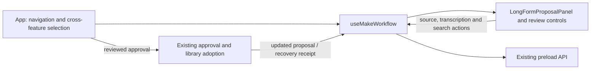

# Make renderer controller

Implemented 2026-10-20.

`src/renderer/make/useMakeWorkflow.ts` owns the long-form source list and selection,
selected transcript, transcription progress subscription, partial-transcript
recovery, clip-search proposals/results/messages, busy flags and cancellation.
Its narrow `MakeApi` uses existing preload methods; it does not import main-process
services or add a second execution queue.

The shell still loads workspace-wide startup snapshots and supplies the source
list to the controller. Settings/index reconciliation can replace that list and
update selected IDs. Transcript saves from review update the controller's selected
transcript. Proposal decisions and approval recovery pass updated records through
`updateProposal`, preserving the receipt and decision fields without exposing the
internal proposal setter.

Navigation, source-to-clip review projection, clip approval/rejection/reopening,
export handoffs and adding an approved clip to Edit remain in `App.tsx`. The busy
state for those decisions also remains in the shell. Importing a source invokes a
callback that asks the shell to open Make.

This extraction preserves current behaviour, including the shell's existing reset
of long-form context when entering Edit. Progress events for other sources and
abandoned source-selection reads remain ignored. This does not add new per-session
guards to long-running command completions or change transcription/search policy.

Validation: `test/makeWorkflow.test.cjs` uses real React in a hidden isolated Electron
renderer with mocked preload methods and a temporary profile. Sixteen scenarios cover
initial state, import, transcription, progress/cancellation, partial recovery,
discovery warnings, search cancellation, stale selection reads, proposal receipt
updates, reset and listener cleanup. Make and Performance share the parameterized
renderer fixture runner. Automated fixtures perform no real transcription,
rendering, model inference, file import or YouTube requests.

Cancellation presentation fix (2026-10-21): Electron IPC prefixes rejected service
messages with the remote-method context. Make now removes that known wrapper
before comparing exact expected cancellation messages for clip search and
long-form transcription. Clip search cancellation stays a normal status message;
other failures remain errors. Regression scenarios include the reported wrapped
message, nested wrappers, retained proposals and genuine failures containing
cancellation wording.

Shared-outcome adoption (2026-10-21): current preload bridges return structured
action outcomes for Make discovery/transcription. Cancellation status now crosses
IPC/contextBridge as data. The message compatibility path remains for older
bridges. See [shared AI execution](shared-ai-execution.md).

Session protection (2026-10-21): [editing-session ownership](editing-session-ownership.md)
adds visit/revision/request guards to command completion and old transcript callbacks.
