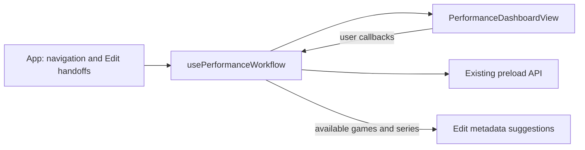

# Performance renderer controller

Implemented 2026-10-19.

`src/renderer/performance/usePerformanceWorkflow.ts` owns dashboard/filter state,
cached reads, refresh, historical imports, coaching, video detail, busy indicators,
and Performance messages. It calls a narrow `PerformanceApi` through the existing
preload API. Tests can inject that same interface with controlled responses.

`App.tsx` composes the existing view and supplies connection/profile information.
It retains clip selection and the coach-to-Edit navigation handoff. Edit's metadata
controller now runs the requested review-first candidate generation. Per-clip YouTube snapshots also remain with Edit's
selected-clip state; the channel dashboard controller does not own those records.
No renderer component accesses main-process services or persistence directly.

This is a behaviour-preserving extraction. Default filters, text trimming, buffered
text commits on Refresh, result normalization, import messages, error routing,
and state retention across navigation remain the same. Existing cached-load effects
still ignore responses after their selection/view effect has been abandoned.

The existing dashboard-entry policy can refresh stale/missing channel data after a
cached read; the controller retains that policy. This targeted extraction does not
reconcile older documentation describing all Performance refreshes as manual-only.
Explicit Refresh, history import and coaching still use their existing API actions.

Validation: `test/performanceWorkflow.test.cjs` bundles the real hook with React and
runs eight behavioural scenarios in an isolated hidden Electron renderer. Fixtures
use fake preload methods and a temporary profile, making no YouTube requests or
model generations. Scenarios cover lazy Edit context, dashboard entry/re-entry,
filter invalidation, normalized refresh, history import, video detail states,
coaching and abandoned cached responses. This is automated renderer verification,
not connected-account acceptance testing.
