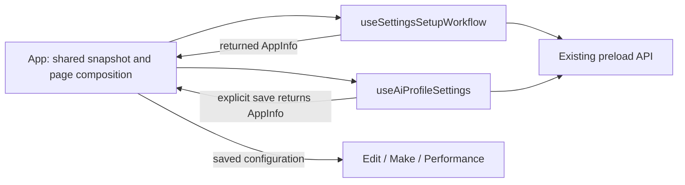

# Settings renderer controllers

Implemented 2026-10-21.

Two focused controllers now own Settings' local setup and AI profile workflows:

- `useSettingsSetupWorkflow` owns runtime/model refresh and import, recommended
  installation, download progress/cancellation, Strict AI, local tool paths,
  transcription backend, workspace folders and automation-setting busy states.
- `useAiProfileSettings` owns profile drafts, selected profile, knowledge/learning
  edits, task-assignment drafts, explicit Save/Cancel and save failure state.
  Profiles and assignments update together as one draft.

Both controllers accept narrow API subsets for testing and call the existing
preload/action routes. They do not access main-process services or persistence.
The shell still owns the shared `AppInfo` snapshot and passes returned snapshots
to consumers across the application.

Profile refresh semantics are now explicit: while the user is editing, newer
saved snapshots update the saved baseline without replacing the draft. Cancel
restores the latest saved baseline. Successful Save adopts the returned
configuration and exits editing; failed Save retains the draft for correction
and retry. Runtime setup never invokes profile Save.

The existing task-specific assignment normalization remains local to user edits,
and becomes persistent only through explicit Save. Adding a profile leaves
existing assignments unchanged. The existing model-preference normalization,
bounded learning limits, custom-profile defaults and knowledge-edit behaviour
are retained in `aiProfileDraft.ts` and the profile controller.

Download progress remains authoritative: requesting cancellation targets the
current progress operation ID and waits for its real terminal event. Existing
non-fatal handling of cancellation rejection and compatibility with a preload
without the progress subscription are preserved. Subscription cleanup belongs
to the setup controller.

This is the AI/local-setup part of Settings. Creator/collaborator profile editing,
YouTube credentials/connections, posting schedules, data management and
cross-feature reconciliation still belong to the shell. Their policies and UI
have not been redesigned. Setup response ordering/concurrency is unchanged.

Validation: `test/settingsWorkflow.test.cjs` runs fifteen real React scenarios in
an isolated hidden Electron renderer using the shared runner and mocked preload
methods. It covers protected drafts across refreshes, Cancel, explicit Save,
validation failures, profile selection/removal/task normalization, knowledge and
learning edits, runtime imports, setup errors, progress/cancellation, local
settings and subscription cleanup. No actual downloads, model imports, settings
writes or platform calls occur in these fixtures.

TypeScript checks, production builds and all 192 Node tests passed. Live
acceptance remains: edit a profile, refresh the runtime, confirm the draft stays,
then exercise Cancel and Save; confirm real setup progress and cancellation when
next performing a download.
