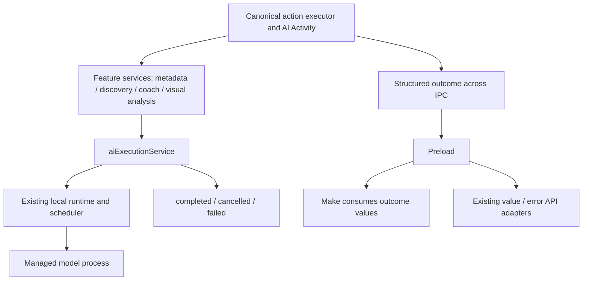

# Shared AI execution boundary

Implemented 2026-10-21; live acceptance pending.

`aiExecutionService.ts` is the shared request boundary for current text/vision
generation callers: clip metadata, owned-video metadata, clip discovery and visual
review, Performance coaching and thumbnail visual analysis. Requests identify the
task/profile and preserve model preferences, prompts, schemas, images, thinking
settings, temperature, timeout and the caller's abort signal.

The boundary delegates model selection, process lifecycle, exclusive ownership,
queue positions and response consumption to the existing local runtime scheduler.
Task-specific prompt construction, evidence validation, JSON parsing, retries and
strict/fallback decisions remain in the feature services.

`workflowOutcome.ts` defines a serializable discriminated union and a typed
cancellation error for in-process compatibility. Cancellation comes from the
request's aborted signal, typed cancellation or exact known legacy cancellation
messages. A timeout/AbortError without caller cancellation remains a failure.
AI Activity uses that classification rather than searching for the word
“cancelled” anywhere in a failure message.

The canonical `app:action` channel accepts an opt-in `returnOutcome` flag. It
wraps the same validated executor; confirmation requirements and action identity
are unchanged. Legacy invocations retain their original value/rejection contract.
Existing preload action methods unwrap the serialized outcome for compatibility.
The new `executeActionOutcome` method returns outcome values through contextBridge,
which avoids depending on custom Error properties surviving that bridge.

Make uses this method for discovery and long-form transcription, reconstituting
cancellation in the renderer from the outcome status. Older bridges/mocks without
it retain the earlier request path and its exact IPC-message compatibility check.
The new preload requires the new main handler; fully restart Electron when
verifying this change.

This boundary covers existing text/vision inference. Whisper, media processing,
embeddings and future image synthesis have not been presented as the same
capability or migrated to a speculative provider framework. Task/profile identifiers
are request context; saved profile resolution remains with the feature services.

Verification includes request forwarding and single dispatch, pre-dispatch and
in-flight cancellation, preserved runtime warnings/truncation, genuine failures,
serialized preload/executor outcomes and confirmation checks, feature routing,
and real React Make scenarios with structured outcomes. Existing scheduler,
coaching, ownership and controller regressions remain part of the full suite.
The serialized bridge test mocks Electron IPC; connected model/live desktop
acceptance is separate.

Live check after restart: start Find Clips and metadata work, cancel Find Clips,
confirm the sidebar says Cancelled with no global error banner and metadata keeps
running; then confirm metadata and Performance coaching still complete normally.
