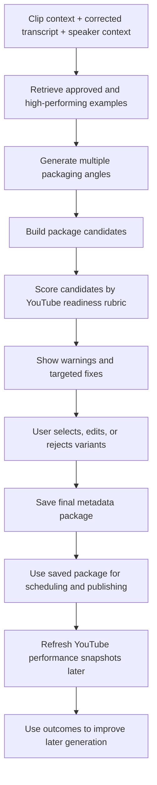

# Creator Workspace Metadata Packaging And Review Spec

As of 2026-07-25.

> **Supporting feature specification.** Current-state, runtime, and MVP status are maintained in [creator-workspace-current-product-plan-2026-08-11.md](../../creator-workspace-current-product-plan-2026-08-11.md). This spec remains the detailed metadata workflow reference; older Ollama-first wording is historical and the current app-owned llama.cpp path is authoritative.

Use this document as the implementation-facing spec for the `metadata generation + review + scoring + feedback` workflow.

Related references:

- [workflow reference](creator-workspace-workflows-and-target-state-2026-07-25.md)
- [workflow diagrams](creator-workspace-workflow-diagrams-2026-07-25.md)
- [transcript and speaker workflow spec](creator-workspace-transcript-and-speaker-workflow-spec-2026-07-25.md)
- [YouTube performance rubric and app guidance](../research/youtube-performance-rubric-and-app-guidance-2026-07-19.md)
- [Splempy YouTube Shorts review and AI heuristics](../research/splempy-youtube-shorts-review-and-ai-heuristics-2026-07-19.md)

## Purpose

Turn metadata from a single text draft into a `review-first packaging system`.

This workflow should help the creator:

- generate multiple packaging options instead of one draft
- compare different title and description angles quickly
- score packages against a YouTube-first readiness rubric
- keep public hashtags separate from platform tags
- preserve structured creator and collaborator attribution
- save one reviewed package for scheduling
- capture approval, edit, rejection, and later performance signals

The goal is not to produce autonomous output and auto-post it.

The goal is to produce `better reviewable decisions` with local AI and local history.

## Product Position

This is a `single-user, local-first packaging workflow`.

It is optimized for:

- `YouTube Shorts first`
- recurring game or series batches
- clip-sized metadata decisions
- local AI generation through Ollama first
- structured user review before publishing

It is not trying to be:

- a keyword stuffing tool
- a generic SEO dashboard
- an algorithm exploit product
- a one-click fully autonomous posting bot

## Current State

Implemented now:

- metadata generation uses Ollama first and heuristic fallback second
- metadata context assembly now uses the corrected saved transcript instead of a flatter raw transcript path
- metadata generation now includes collaborator presence context from selected collaborators and trusted transcript speaker assignments
- the app generates:
  - multiple title variants
  - multiple description variants
  - public hashtag sets
  - YouTube platform tag sets
- metadata is reviewed in a guided workflow
- the app stores a selected package per clip
- YouTube readiness scoring exists in the workflow
- descriptions can append creator and collaborator profile blocks
- metadata feedback is already stored
- YouTube performance snapshots can be refreshed for workspace-managed uploads

Still missing or weak:

- clearer explanation for why a package scored well or poorly
- stronger use of transcript and speaker context inside prompts and review
- clearer comparison history across generated variants
- stronger retrieval from prior approved and high-performing examples
- tighter connection between package review and later scheduling decisions

## End-State Outcome

The user should be able to take a reviewed clip through this flow:

1. assemble clip, transcript, speaker, series, and game context
2. generate multiple metadata candidates by angle
3. compare and score candidate packages
4. inspect warnings and suggested fixes
5. select or edit the best package
6. save the package as the scheduling payload
7. record whether the generation was approved, edited, or rejected
8. later refresh YouTube outcomes and use them to improve future generation

## Primary User Stories

1. As a creator, I want more than one title angle so I can choose the best packaging for the same clip.
2. As a creator, I want the AI to use transcript, game, and collaborator context so metadata sounds grounded instead of generic.
3. As a creator, I want the app to score drafts against clear YouTube-first rules so I know what is weak before scheduling.
4. As a creator, I want public hashtags, platform tags, and internal context kept separate so metadata stays clean.
5. As a creator, I want my edits and later publish results to improve future generation over time.

## Workflow Diagram

## Scope

### In scope now

- local metadata generation with Ollama
- heuristic fallback generation
- multi-variant titles, descriptions, public hashtags, and YouTube platform tags
- selected package persistence
- YouTube-first readiness scoring
- creator and collaborator profile blocks in descriptions
- metadata feedback capture
- on-demand YouTube performance refresh

### Next scope

- clearer score explanations
- stronger variant comparison history
- stronger retrieval from approved and high-performing workspace examples
- better transcript and speaker context visibility in generation and review
- clearer schedule handoff rules per platform

### Out of scope for this spec

- thumbnails
- auto-posting without review
- fully autonomous prompt loops that regenerate until they self-pass
- cross-platform parity scoring in this milestone
- paid external keyword tools as a required dependency
- model fine-tuning infrastructure

## Functional Requirements

### 1. Context assembly

The generation pipeline must assemble context from structured workspace data before prompting.

Required inputs:

- clip name
- clip duration
- corrected transcript text
- transcript segment timing summary where useful
- `seriesKey`
- `gameTitle`
- collaborator presence or identity context
- creator profile block settings
- collaborator profile block settings

Preferred retrieval inputs:

- recent approved examples from the same series
- high-performing examples from the same series
- fallback approved/high-performing channel examples when the series is thin

Rules:

- transcript context should come from the corrected canonical transcript, not a stale draft
- speaker and collaborator context should shape attribution and description blocks
- context assembly should remain deterministic enough to debug

### 2. Candidate generation

The app must generate multiple candidate variants, not one draft blob.

Expected YouTube-first candidate shape:

- `3` title variants
  - `specific_fail`
  - `panic_tension`
  - `social_chaos`
- `2` description variants
  - `context_forward`
  - `search_forward`
- `2` public hashtag sets
- `1` YouTube platform tag set

Rules:

- Ollama remains the primary generation path
- heuristic fallback must produce the same output shape
- fallback output should be marked lower confidence internally
- title generation should prefer concrete event framing over vague reaction language
- title generation should stay biased toward proven emotional frames:
  - chaos
  - panic
  - betrayal
  - clutch
  - humiliation
  - absurdity
  - sudden failure
  - near-disaster

### 3. Package composition

The app must build reviewable metadata packages from generated pieces.

A package should include:

- title
- description
- public hashtags
- platform tags
- `seriesKey`
- `gameTitle`
- selected variant references
- score snapshot

Rules:

- public hashtags and platform tags must stay separate
- descriptions should support reusable structured blocks instead of ad hoc long paragraphs
- creator links should appear when enabled
- collaborator attribution should appear only when collaborators are relevant to the clip

### 4. Description structure

For Shorts-first workflows, the description should stay lightweight and block-based.

Preferred structure:

1. hook line
2. short context line
3. optional collaborator line
4. optional creator links block
5. optional collaborator links block
6. short hashtag line

Rules:

- avoid overlong generic paragraphs
- avoid repeating the title without adding context
- use structured app data for profiles and collaborators before asking the model to improvise names or links

### 5. Scoring and warnings

The app must score candidate packages against a YouTube-first readiness rubric.

Rubric weights:

- `audience and topic fit`: `20`
- `packaging clarity`: `20`
- `hook strength`: `20`
- `retention and payoff structure`: `15`
- `search and context clarity`: `10`
- `session and channel connection`: `10`
- `metadata hygiene`: `5`

Expected warning categories:

- vague reaction title
- mismatch between title promise and transcript opening
- missing game or series context where clarity needs it
- likely delayed payoff
- bloated or generic tag set
- description too long or too empty for Shorts
- collaborator attribution missing when collaborator context is present

Rules:

- low scores should warn, not block scheduling
- the system should favor actionable warnings over opaque numbers
- scores should eventually calibrate against workspace history rather than remain static forever

### 6. Feedback capture

The app must capture user decisions on generated metadata.

Supported decisions:

- `approved`
- `edited`
- `rejected`

Rules:

- `approved` means the generated text was accepted with no material change
- `edited` means the generated text was changed materially before save
- `rejected` must come from an explicit reject action
- silent abandonment should not be treated as rejection

### 7. Scheduling handoff

Scheduling must use the saved selected package, not an unsaved candidate.

Rules:

- the saved package is the canonical publish payload for scheduling
- YouTube uploads should use `platformTags`
- public hashtags should already be embedded into title or description when intended
- TikTok may reuse shared generation logic later, but it does not need YouTube-specific scoring to function in this milestone

### 8. Performance refresh and learning

The workflow must support on-demand post-publish learning for workspace-managed YouTube uploads.

Expected stored signals:

- views
- engaged views
- estimated minutes watched
- average view duration
- average view percentage
- likes
- comments
- fetch timestamp

Rules:

- `engaged views` should be the primary Shorts comparison metric when available
- raw public views should be treated as weaker alone, especially after the `2025-03-31` Shorts views change
- learning in this milestone should come from retrieval and score calibration, not model fine-tuning

## Data Model Requirements

The workflow depends on these conceptual records.

### Clip metadata package

Required fields:

- `clipId`
- `title`
- `description`
- `publicHashtags`
- `platformTags`
- `seriesKey`
- `gameTitle`
- `selectedVariantIds`
- `latestScoreSnapshot`
- `createdAt`
- `updatedAt`

### Metadata variant

Required fields:

- `id`
- `clipId`
- `platform`
- `kind`
- `angle`
- `content`
- `source`
- `createdAt`

Supported kinds:

- `title`
- `description`
- `public_hashtags`
- `platform_tags`

Supported angles:

- titles:
  - `specific_fail`
  - `panic_tension`
  - `social_chaos`
- descriptions:
  - `context_forward`
  - `search_forward`
- hashtags and tags:
  - `default`
  - `alt`

### Metadata score snapshot

Required fields:

- `total`
- `audienceTopicFit`
- `packagingClarity`
- `hookStrength`
- `retentionPayoff`
- `searchContextClarity`
- `sessionConnection`
- `metadataHygiene`
- `warnings`

### Metadata feedback

Required fields:

- `id`
- `clipId`
- `variantId`
- `decision`
- `createdAt`

### YouTube performance snapshot

Required fields:

- `id`
- `clipId`
- `scheduledPostId`
- `videoId`
- `views`
- `engagedViews`
- `estimatedMinutesWatched`
- `averageViewDuration`
- `averageViewPercentage`
- `likes`
- `comments`
- `fetchedAt`

## UI Requirements

### Clip context inputs

The metadata workflow should expose:

- `gameTitle`
- `seriesKey`
- collaborator presence context where available

### Candidate sections

The review UI should expose:

- title variants with angle labels
- description variants
- public hashtag sets
- platform tag set

### Package editor

The editor should expose final editable fields for:

- title
- description
- public hashtags
- platform tags

### Readiness panel

The review UI should expose:

- total YouTube readiness score
- sub-scores by rubric category
- warnings
- targeted actions for regeneration by field group

### Feedback actions

The workflow should expose:

- `Select`
- `Reject`
- `Save Package`
- `Refresh YouTube Performance`

### UX principles

The workflow should make it obvious:

- what was generated
- what was selected
- what was edited
- why a package looks weak
- what scheduling will actually use

## Error And Edge-Case Handling

### Generation failures

The app should clearly handle:

- no reachable Ollama runtime
- no configured model
- generation timeout
- malformed model output
- heuristic fallback activation

### Review edge cases

The app should clearly handle:

- no transcript yet
- thin or missing series context
- no collaborator data for a co-op clip
- packages that all score poorly
- user edits that materially diverge from every selected variant

### UX principle

The system should prefer:

- explicit warnings
- reviewable fallbacks
- preserving the user’s chosen final package

It should avoid:

- hiding fallback behavior
- silently replacing edited user text
- pretending scores are certainty rather than guidance

## Quality Bar

This workflow is successful when:

- generated packages feel grounded in the actual clip
- titles are more concrete and less generic than a naive single-shot prompt
- the creator can compare options quickly without losing control
- scoring helps the user see weaknesses before scheduling
- the saved package is clean enough to reuse reliably in publishing
- later retrieval makes generation feel more tailored over time

## Implementation Phasing

### Phase 1: Baseline packaging workflow

Includes:

- local generation
- heuristic fallback
- title, description, hashtag, and tag candidates
- selected package persistence
- editable package fields

### Phase 2: YouTube-first review system

Includes:

- readiness scoring
- warnings
- field-group regeneration
- creator and collaborator description blocks
- schedule handoff from saved package

### Phase 3: Feedback and retrieval hardening

Add next:

- stronger variant comparison history
- clearer approved vs edited vs rejected signals
- stronger retrieval from approved and high-performing examples
- clearer score explanation in the UI

### Phase 4: Learning improvements

Later candidates:

- stronger series-aware retrieval
- better score calibration from workspace outcomes
- richer cross-workflow use of transcript and speaker context
- later cross-platform packaging rules where platform capabilities diverge usefully

## Immediate Backlog Translation

These are the most useful next implementation tasks from this spec.

1. explain score warnings more clearly in the UI
   - why the title was penalized
   - where context is missing
   - which field should be improved first
2. strengthen transcript and speaker context in prompt assembly
   - use corrected transcript
   - surface game, series, and collaborator presence more explicitly
3. add stronger retrieval from prior approved and high-performing examples
   - same series first
   - channel-wide fallback second
4. add clearer variant history and selection state
   - what was selected
   - what was later edited
   - what was explicitly rejected
5. tighten scheduling handoff rules
   - always publish from the saved package
   - make saved vs unsaved state obvious in the UI
6. improve tag and hashtag hygiene
   - penalize generic padding
   - keep game and moment identity ahead of broad weak tags

## Design Decision Summary

These decisions should be treated as current product direction unless we explicitly revisit them.

1. `Review-first, not autonomous`
   - the app proposes packaging; the user approves it
2. `YouTube Shorts first`
   - the first deep scoring system is optimized for Shorts packaging decisions
3. `Multiple variants, not one blob`
   - comparison is a core feature, not an optional extra
4. `Structured metadata fields`
   - public hashtags, platform tags, and internal context should stay distinct
5. `Local AI first`
   - Ollama is primary, heuristic fallback keeps the workflow usable
6. `Feedback is product data`
   - approved, edited, rejected, and performed are all useful signals, but they are not the same signal
