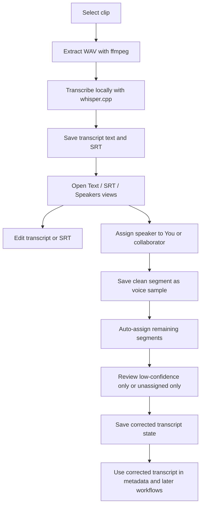

# Creator Workspace Transcript And Speaker Workflow Spec

As of 2026-07-25.

> **Supporting feature specification.** Current-state and MVP closure status are maintained in [creator-workspace-current-product-plan-2026-08-11.md](../../creator-workspace-current-product-plan-2026-08-11.md). This document remains the detailed transcript, speaker-review, and deferred diarisation reference.

Use this document as the implementation-facing spec for the `transcription + transcript correction + speaker review + voice sample` workflow.

Related references:

- [workflow reference](creator-workspace-workflows-and-target-state-2026-07-25.md)
- [workflow diagrams](creator-workspace-workflow-diagrams-2026-07-25.md)
- [MVP plan and backlog](creator-workspace-mvp-plan-and-backlog-2026-07-19.md)
- [user stories and tasks](creator-workspace-user-stories-and-tasks-2026-07-19.md)

## Purpose

Turn local transcription into a dependable `canonical content understanding layer` for the rest of the app.

This workflow should do more than produce text. It should let the creator:

- generate a local transcript
- correct that transcript
- identify who is speaking
- save reusable voice samples for `You` and recurring collaborators
- auto-assign speaker labels over time
- focus review effort on only the uncertain segments
- reuse timed transcript segments for clip-local caption preview, correction, and simple burn-in export

The corrected transcript and speaker assignments should then become trusted inputs for:

- metadata generation
- collaborator-aware descriptions
- later subtitle rendering
- later clip suggestion and ranking systems

## Product Position

This is a `single-user, local-first desktop workflow`.

It is optimized for:

- one creator
- one machine
- recurring collaborators or co-op partners
- local tools and local storage by default

It is not trying to be:

- a cloud transcription service
- a general team caption editor
- a full diarization research platform

## Current State

Implemented now:

- local transcription runs through `ffmpeg` plus `whisper.cpp`
- transcript text and `SRT` are stored locally per clip
- transcript views support `Text`, `SRT`, and `Speakers`
- transcript text and `SRT` can be edited in-app
- transcript segments can be assigned to `You` or a saved collaborator
- creator and collaborator voice samples can be captured from transcript segments
- speaker auto-assignment runs from saved voice samples
- auto-assigned segments carry confidence/source state:
  - `manual`
  - `auto high confidence`
  - `auto low confidence / needs review`
- low-confidence and no-match speaker results can now carry review notes and competing-speaker hints
- the speaker workflow supports review filters:
  - `All`
  - `Needs Review`
  - `Unassigned`
- the non-editing speaker review flow now supports rerunning only `needs review` segments

Still missing or weak:

- explanation for why a segment is low confidence
- sample quality scoring and duplicate detection
- transcript issue indicators beyond manual inspection
- selective rerun actions for only low-confidence or only unassigned segments
- stronger local speaker modeling if the current heuristic approach plateaus

## End-State Outcome

The user should be able to take a clip through this flow:

1. transcribe locally
2. review and correct transcript text
3. assign a few clean speaker examples to `You` and collaborators
4. save those examples as reusable voice samples
5. auto-assign the remaining transcript segments
6. review only uncertain segments
7. save a corrected transcript that downstream AI can trust

## Primary User Stories

1. As a creator, I want a local transcript so I do not pay recurring API cost for every clip.
2. As a creator, I want to correct transcript mistakes before they affect metadata or captions.
3. As a creator, I want recurring voices recognized so I do not have to relabel every clip manually.
4. As a creator, I want low-confidence speaker matches isolated quickly so review stays fast.
5. As a creator, I want the app to know when I am speaking versus when a collaborator is speaking so descriptions and later subtitles can frame the content correctly.

## Workflow Diagram

## Scope

### In scope now

- local transcription job execution
- transcript persistence
- in-app transcript editing
- `SRT` editing and export
- manual speaker assignment
- creator voice sample capture
- collaborator voice sample capture
- auto-assignment from saved samples
- confidence/source badges
- focused review of low-confidence and unassigned segments
- selecting transcript timing that overlaps an approved long-form clip candidate
- simple caption preview, text/timing correction, readable style selection, and burn-in export for approved candidates

### Next scope

- explainable confidence review
- sample quality checks
- selective speaker reruns
- transcript issue indicators

### Out of scope for this spec

- cloud transcription providers
- automatic face recognition
- full visual person recognition
- animated word-by-word captions, speaker colours, keyword highlighting, and template packs
- multi-user review workflows
- model fine-tuning infrastructure

## Functional Requirements

### 1. Local transcription

The app must:

- extract audio locally from the source clip
- normalize audio into a transcription-friendly format
- run a local transcription engine
- save transcript text plus timed segments
- expose clear success, empty, and failure states in the UI

Expected behavior:

- transcription should be rerunnable
- reruns should update the saved transcript for the clip
- transcript persistence should remain local to the workspace

### 2. Transcript editing

The app must allow the user to:

- open transcript text view
- open `SRT` view
- edit transcript text
- edit timed subtitle lines
- save corrected transcript content back into the workspace

Rules:

- saved transcript content becomes the canonical local version for downstream workflows
- transcript edits should not silently discard existing speaker assignments where segment identity can be preserved
- if segment structure changes materially, the app should preserve only the assignments that can be matched safely

### 3. Speaker assignment

The app must allow each transcript segment to be:

- unassigned
- assigned to `You`
- assigned to a saved collaborator

Every speaker-assigned segment should carry:

- `speakerId`
- `speakerConfidence`
- `speakerAssignmentSource`

Supported assignment sources:

- `manual`
- `auto_high_confidence`
- `auto_low_confidence`

Rules:

- manual assignments are authoritative
- auto-assignment must not overwrite a manual assignment
- if a collaborator is deleted, affected transcript segments should fall back safely rather than keep stale references

### 4. Voice sample capture

The app must support saving reusable voice samples for:

- the creator / self
- saved collaborators

Voice sample capture should happen from a transcript segment that the user has already identified as a clean example.

Rules:

- samples belong to a specific speaker identity
- creator and collaborator identities should live in one coherent profile system, not separate unrelated systems
- a saved sample should be removable later
- sample capture should not require leaving the transcript workflow

### 5. Auto-assignment

The app must support auto-assigning transcript speakers by comparing transcript segments against saved voice samples.

Expected outputs per segment:

- matched speaker or no match
- confidence value
- assignment source category

Rules:

- high-confidence segments should be assigned automatically
- low-confidence segments should be marked for review, not treated as fully trusted
- segments without a useful match should remain unassigned
- manual assignments should be left untouched

### 6. Review workflow

The app must support filtering transcript review to:

- all segments
- low-confidence segments
- unassigned segments

This workflow should minimize wasted review effort.

Rules:

- low-confidence review should be one click away after auto-assignment
- the user must be able to correct a segment manually during review
- once corrected manually, the segment should become `manual`

### 7. Downstream usage

The saved transcript and speaker state should be usable by later workflows.

Immediate uses:

- metadata generation context
- collaborator-aware description generation

Later uses:

- subtitle styling by speaker color
- collaborator tagging suggestions
- clip suggestion and ranking context

## Data Model Requirements

The workflow depends on these conceptual records.

### Transcript segment

Required fields:

- `id`
- `clipId`
- `startMs`
- `endMs`
- `text`
- `speakerId | null`
- `speakerConfidence | null`
- `speakerAssignmentSource | null`

### Creator voice sample

Required fields:

- `id`
- `speakerId`
- `clipId`
- `segmentId`
- `label`
- `audioSignature`
- `createdAt`

### Collaborator profile

Required fields:

- `id`
- `name`
- `transcriptColor`
- `socialLinks`
- `voiceSamples`

### Collaborator voice sample

Required fields:

- `id`
- `speakerId`
- `clipId`
- `segmentId`
- `label`
- `audioSignature`
- `createdAt`

## UI Requirements

### Transcript views

The clip transcript area should expose:

- `Text`
- `SRT`
- `Speakers`

### Speaker review controls

The speaker workflow should expose:

- manual speaker selection
- `Save My Voice Sample`
- `Save Voice Sample` for collaborators
- `Auto-Assign From Voice Samples`
- `Review Low-Confidence Only`
- filters for `All`, `Needs Review`, and `Unassigned`

### Segment row state

Each segment in the speaker review UI should show:

- transcript text
- timing
- current speaker assignment
- whether assignment is manual or automated
- confidence/status badge when automated

### Settings dependencies

Settings should expose:

- creator links
- creator voice samples
- collaborator profiles
- collaborator links
- collaborator transcript color
- collaborator voice samples

## Error And Edge-Case Handling

### Transcription failures

The app should clearly handle:

- missing `ffmpeg`
- missing `whisper.cpp`
- missing model path
- engine execution failure
- empty transcript output

### Speaker review edge cases

The app should clearly handle:

- no creator voice samples saved yet
- no collaborator voice samples saved yet
- auto-assignment with too little reference data
- deleted collaborator profile that had prior assignments
- transcript edits that invalidate earlier segment matches

### UX principle

The system should prefer:

- explicit warnings
- safe fallback
- preserving user edits

It should avoid:

- silent data loss
- silent speaker reassignment
- forcing the user through a rigid wizard

## Quality Bar

This workflow is successful when:

- transcription is dependable enough to edit rather than rebuild manually
- speaker review gets faster over time as voice samples accumulate
- the creator can isolate uncertain segments instead of rereading the entire transcript
- downstream metadata becomes more grounded because transcript and speaker context are cleaner

## Implementation Phasing

### Phase 1: Baseline local transcript workflow

Includes:

- local transcription
- transcript persistence
- transcript and `SRT` views
- transcript editing
- `SRT` export

### Phase 2: Speaker-aware review layer

Includes:

- manual speaker assignment
- creator and collaborator profiles
- creator and collaborator voice sample capture
- auto-assignment from saved samples
- confidence/source states
- focused review filters

### Phase 3: Hardening and explainability

Add next:

- why-low-confidence explanation
- sample quality guidance
- selective rerun actions
- transcript issue indicators

### Phase 4: Stronger intelligence

Later candidates:

- stronger local speaker embeddings or diarization
- subtitle styling informed by speaker identity
- deeper metadata and clip suggestion usage of transcript/speaker context

## Deferred Future Capability: High-Accuracy Local Speaker Diarisation And Enrolled Profiles

Status: explicitly deferred. This is not active implementation work and should not displace current clip-proposal quality or other workflow priorities.

The future capability should combine two separate functions:

- **Diarisation:** determine who spoke when and produce speaker-homogeneous time regions, without claiming a real-world identity.
- **Profile matching:** compare those regions with consented, locally enrolled voice profiles and assign a known speaker such as `Chris` or a saved collaborator when confidence is sufficient. Otherwise the result remains `Unknown`.

### Proposed local architecture

- Keep the current Whisper transcript and timed-segment flow as the text and timing source.
- Run a local high-accuracy diarisation model alongside that flow, with a `pyannote Community-1`-style pipeline as the initial architecture candidate.
- Extract clean, consented enrollment samples from the creator or collaborator workflow rather than inferring identity from unapproved footage.
- Store speaker embeddings locally and associate them with an enrolled profile, model version, sample provenance, and consent state.
- Align diarisation regions with Whisper segments, preserving the diarisation boundaries and retaining the transcript text/timing as the canonical content layer.

### Confidence and review rules

- Apply explicit thresholds for both diarisation quality and known-profile matching.
- Never turn a low-confidence similarity into an automatic identity claim; use `Unknown` or `Needs review` instead.
- Let the creator rename, merge, split, correct, or leave an unknown speaker region unresolved.
- Keep manual corrections authoritative and auditable.
- Feed approved corrections back into stored profile evidence and future matching calibration, not into silent base-model fine-tuning.

### Privacy and operational constraints

- Enrollment requires explicit consent from the creator or collaborator.
- Audio samples, embeddings, and identity mappings remain local-first and must not be uploaded by default.
- The UI must show whether a label came from diarisation, profile matching, or manual review.
- Model/runtime availability, processing time, and uncertain matches must be visible and recoverable.
- The original media and canonical transcript must remain untouched by analysis retries.

### Deferred acceptance direction

This capability is ready for later design and benchmarking when the current workflow priorities allow it. It should be accepted only when the app can show speaker regions, known-profile matches, confidence, `Unknown` fallback, consent provenance, and reviewable corrections end to end. It is not a commitment to download or implement the model now.

## Immediate Backlog Translation

These are the most useful next implementation tasks from this spec.

1. explain low-confidence matches in the UI
   - likely competing speaker
   - why the match was downgraded
2. add voice sample quality checks
   - duplicate or near-duplicate warning
   - weak / noisy sample warning
3. add selective rerun actions
   - rerun only `Needs Review`
   - rerun only `Unassigned`
4. add transcript issue indicators
   - long silence before first speech
   - suspiciously short or empty segment
   - unusually dense or low-confidence transcript spans
5. define how corrected speaker-aware transcript state is passed into metadata generation

## Design Decision Summary

These decisions should be treated as current product direction unless we explicitly revisit them.

1. `Local-first`
   - transcription and speaker matching stay local by default
2. `Manual edits win`
   - user decisions override automation
3. `Confidence drives review focus`
   - low-confidence results should narrow review effort, not pretend certainty
4. `One identity system`
   - collaborator links, transcript colors, and voice samples belong together
5. `Transcript becomes canonical`
   - corrected transcript state is not a side artifact; it is a core app asset
