# Creator Workspace Workflow Diagrams

As of 2026-07-25.

> **Historical diagrams.** Use [creator-workspace-current-product-plan-2026-08-11.md](../../creator-workspace-current-product-plan-2026-08-11.md) for the current workflow and implementation status. These diagrams preserve earlier state/target discussions and may contain pre-implementation gaps.

This document turns the workflow reference into visual diagrams that are easier to use in planning, design, and implementation discussions.

Use it alongside:

- [workflow reference](creator-workspace-workflows-and-target-state-2026-07-25.md)
- [transcript and speaker workflow spec](creator-workspace-transcript-and-speaker-workflow-spec-2026-07-25.md)
- [metadata packaging and review spec](creator-workspace-metadata-packaging-and-review-spec-2026-07-25.md)
- [MVP plan and backlog](creator-workspace-mvp-plan-and-backlog-2026-07-19.md)
- [user stories and tasks](creator-workspace-user-stories-and-tasks-2026-07-19.md)
- [consolidated roadmap](creator-workspace-consolidated-roadmap-2026-07-19.md)

## How To Use These Diagrams

- `Current state` diagrams show what the app can do now.
- `Target state` diagrams show the workflow we are aiming to build.
- `Gaps` under each diagram highlight the next requirements that should become implementation tasks.

## Diagram 1: Product Spine

### Current state

```mermaid
flowchart LR
    A["Import clip"] --> B["Run local transcription"]
    B --> C["Review transcript text / SRT"]
    C --> D["Assign speakers"]
    D --> E["Capture creator or collaborator voice samples"]
    E --> F["Auto-assign speakers from saved samples"]
    F --> G["Review low-confidence or unassigned segments"]
    G --> H["Generate metadata candidates"]
    H --> I["Review and save metadata package"]
    I --> J["Schedule post"]
    J --> K["Publish to YouTube or plan TikTok handoff"]
    K --> L["Refresh YouTube performance snapshots"]
```

### Target state

```mermaid
flowchart LR
    A["Import clips or 2-4 hour source videos"] --> B["Index source and prepare resumable background jobs"]
    B --> C["Transcribe and prepare lightweight preview"]
    C --> D["Propose transcript-led candidate clips"]
    D --> E["Preview, trim, correct captions, and approve"]
    E --> F["Resolve speakers with reusable voice identity"]
    F --> G["Generate and score metadata packages"]
    G --> H["Schedule by platform capability"]
    H --> I["Publish or hand off platform jobs"]
    I --> J["Capture performance and approval outcomes"]
    J --> K["Improve future AI suggestions and packaging"]
```

### Gaps

1. long-form source intake, candidate review, and export
2. stronger duplicate handling and project grouping
3. richer transcript QA and navigation
4. stronger speaker confidence explanation
5. stronger YouTube and TikTok queue handling
6. tighter feedback loop from outcomes back into generation

## Diagram 2: Transcript And Speaker Workflow

### Current state

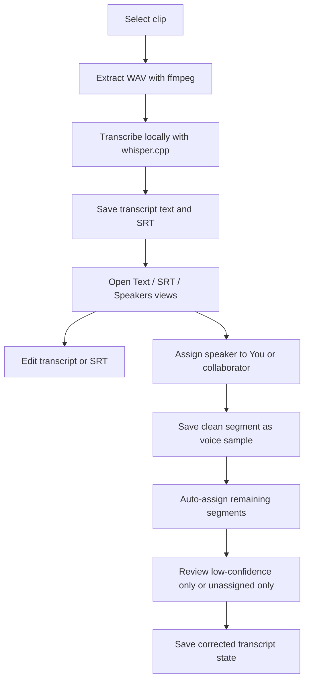

### Target state

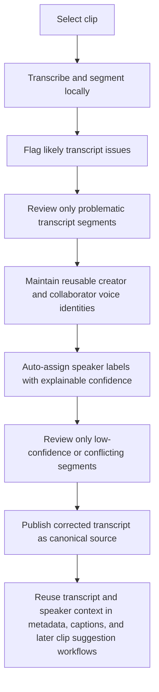

### Gaps

1. transcript issue indicators
2. why-low-confidence explanation
3. sample quality and duplicate detection
4. selective rerun for only low-confidence or only unassigned segments
5. later stronger local diarization / speaker embedding approach

## Diagram 3: Metadata Packaging And Review

### Current state

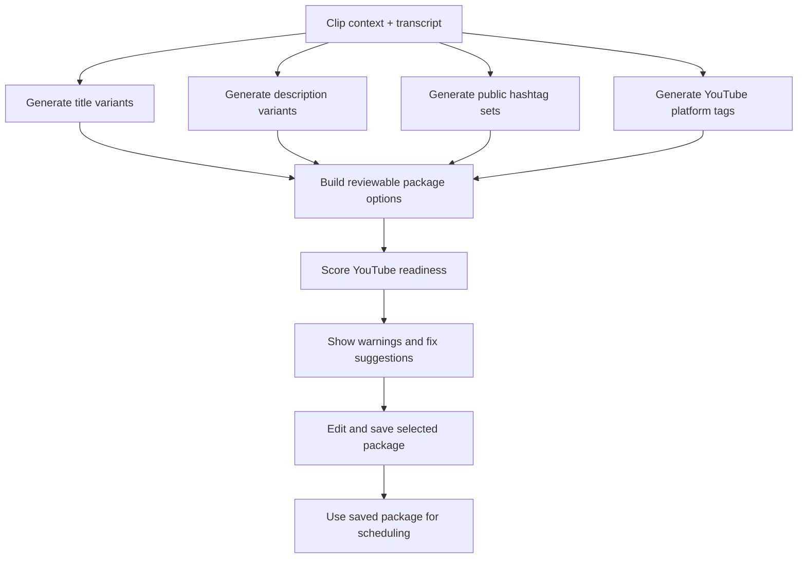

### Target state

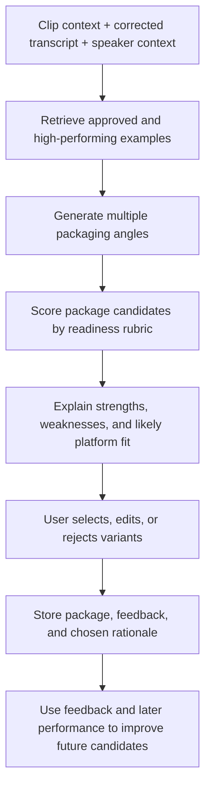

### Gaps

1. clearer score explanations in the UI
2. stronger use of transcript and speaker context in prompts
3. clearer comparison and selection history
4. stronger retrieval from approved and high-performing workspace examples

## Diagram 4: Scheduling And Publishing

### Current state

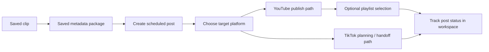

### Target state

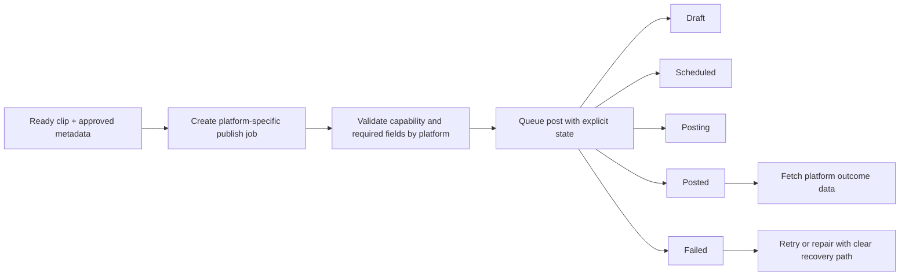

### Gaps

1. harder YouTube failure handling
2. clearer TikTok handoff behavior
3. better queue and calendar review surface
4. add more platforms only where capability and workflow stay explicit

## Diagram 5: Learning Loop

### Current state

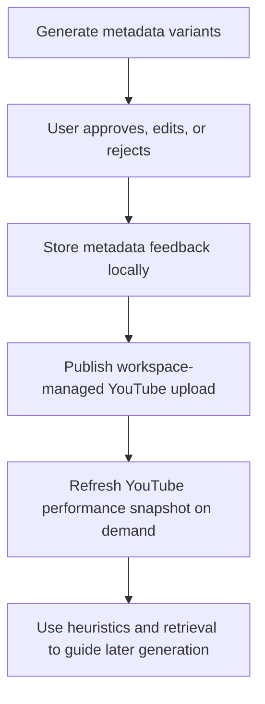

### Target state

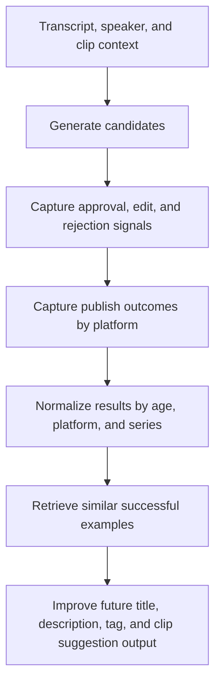

### Gaps

1. stronger workspace example retrieval
2. more visible feedback history in the UI
3. shared learning loop for future clip suggestion approval and rejection

## Diagram 7: Long-Form To Clip Review Front Stage

### Current state

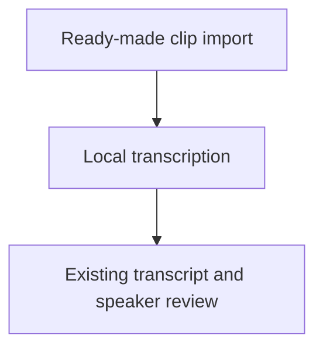

There is not yet a dedicated long-form source intake, candidate review, caption burn-in, or candidate-to-clip promotion path.

### Target state

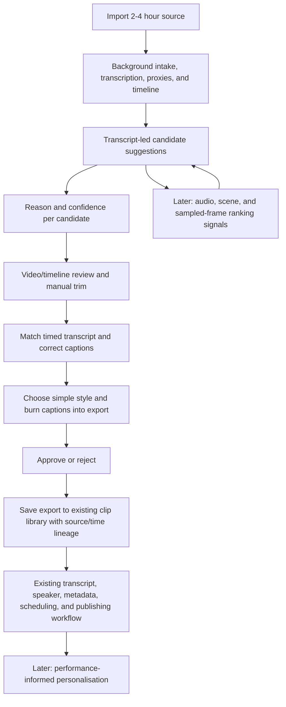

### Gaps

1. separate Settings folder selector and source-library validation
2. resumable long-running source jobs and storage accounting
3. lightweight proxy/preview generation
4. candidate model with evidence, confidence, reason, and review decisions
5. in-app timeline trim and transcript-linked caption editing/export
6. richer audio/scene/frame analysis and supervised ranking personalisation

## Diagram 6: Supporting Settings And Identity Data

### Current state

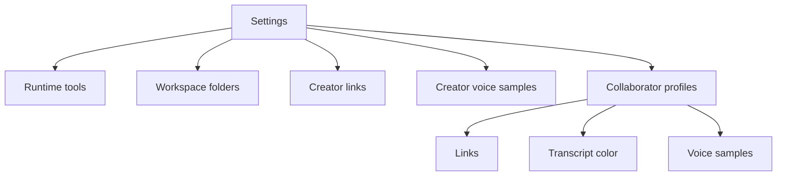

### Target state

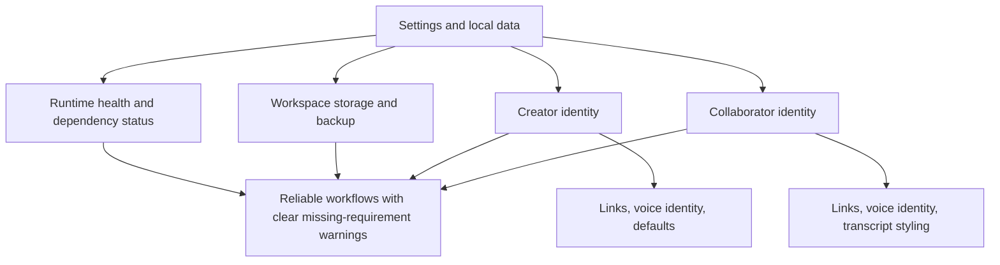

### Gaps

1. runtime dependency health checks
2. backup or export for local settings and profile data
3. clearer local runtime setup and migration docs

## Recommended Order For Design Docs

1. `Long-form to clip review front stage`
   - use this for the next major implementation vertical
2. `Product spine`
   - use this as the overview diagram in roadmap and README-level product docs
3. `Transcript and speaker workflow`
   - use this for the next implementation-focused design doc
4. `Metadata packaging and review`
   - use this for the next AI behavior and UI workflow spec
5. `Scheduling and publishing`
   - use this for adapter and queue design
6. `Learning loop`
   - use this once feedback and performance begin shaping generation behavior more directly
